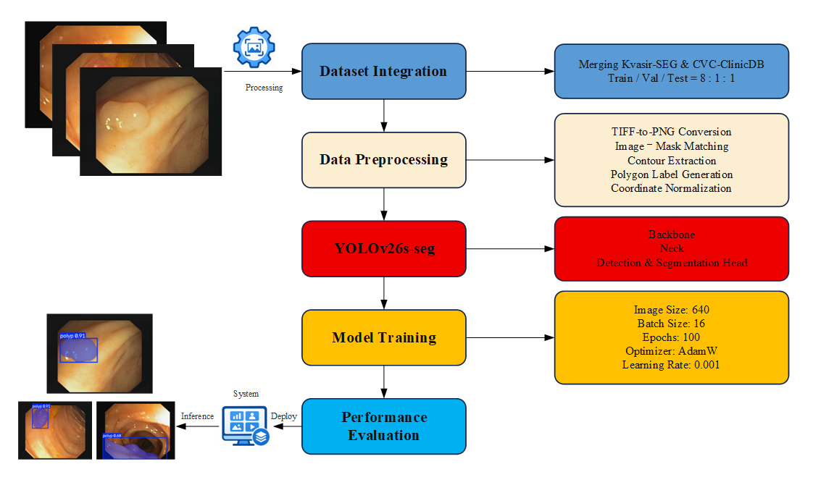
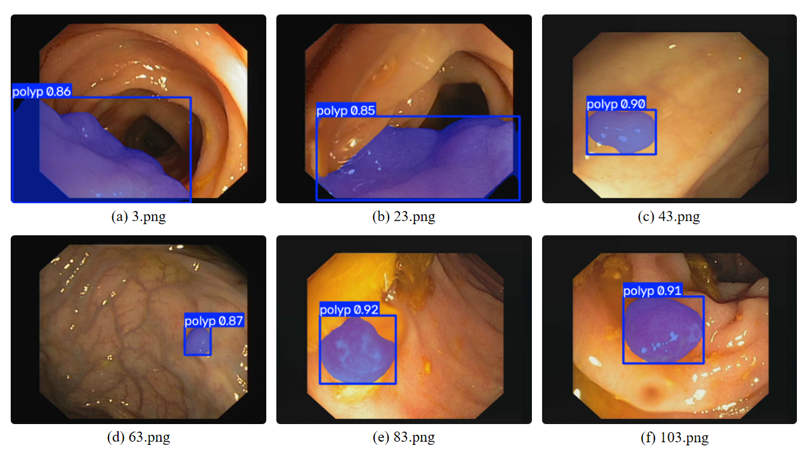

# Endoscopic Polyp Detection and Segmentation System

This is a simple framework diagram example for our research project.


And we will also display some detection results related to this project in the figure below.


A project on colorectal polyp detection and segmentation in endoscopic imagery.
YOLO instance-segmentation models are trained on two public polyp datasets, and the trained
model is served through a FastAPI backend and a Streamlit clinical-workflow frontend.

**Project status:** research prototype. Data preparation, training, evaluation, and the serving
stack are implemented.
---

## Table of Contents

- [Overview](#overview)
- [System Architecture](#system-architecture)
- [Project Structure](#project-structure)
- [Environment Requirements](#environment-requirements)
- [Installation](#installation)
- [Dataset Preparation](#dataset-preparation)
- [Model Training](#model-training)
- [Model Evaluation](#model-evaluation)
- [System Deployment](#system-deployment)
- [Documentation](#documentation)


---

## Overview

Colorectal polyps are precursors of colorectal cancer, and delineating them during colonoscopy
is a repetitive, attention-demanding task. This project asks whether a lightweight single-stage
instance-segmentation detector is sufficient for practical polyp segmentation, and wraps the
answer in a small hospital-style information system so the model can be exercised end to end
rather than only inside a notebook.

**Objectives**

- Build a reproducible pipeline that merges two public polyp datasets into one YOLO
  segmentation dataset.
- Train and compare several YOLO segmentation variants on it.
- Quantify mask quality with region-overlap metrics (Dice, IoU) rather than classification
  accuracy alone.
- Prototype a deployable system around the trained model.

**Features**

- **Data pipeline** — CVC-ClinicDB TIF normalisation, dataset merge with prefix-based naming,
  mask-to-YOLO-polygon conversion, source-stratified train/val/test split, optional
  train-only Albumentations augmentation.
- **Training** — one unified Ultralytics entry point with a fixed experimental recipe and
  resolved dataset paths.
- **Serving** — JWT login with `physician` / `admin` roles, patient records, batch image and
  video inference, detection history with CSV export and per-patient PDF reports, statistics
  dashboard, user management, and an audit log.

---

## System Architecture

```
Research pipeline
  raw datasets
      → convert_cvc_to_png → merge_kvasir_cvc → prepare_yolo_noaug | prepare_yolo_aug
      → train_seg_common → trained *.pt
      → compare_yolo_vs_cascade → outputs/eval/

Serving pipeline
  browser → Streamlit (system/frontend) → FastAPI (system/backend) → YOLO inference service
                                            ├─ SQLite  system/backend/history.db
                                            └─ static/uploads, static/results
```

| Stage | Location | Responsibility |
|---|---|---|
| Data preprocessing | `scripts/data_pro/` | Dataset conversion, merge, YOLO-format export, split |
| Model training | `scripts/model_train/` | Dataset validation and Ultralytics training |
| Model inference (cascade) | `scripts/inference/` | YOLO + SAM mask refinement — **incomplete** |
| Model evaluation | `scripts/eval/` | Dice / IoU against ground-truth masks |
| Backend | `system/backend/` | REST API, authentication, persistence, inference service |
| Frontend | `system/frontend/` | Streamlit multi-page UI; no model code |

The frontend holds no model: every prediction crosses the HTTP boundary to the backend, so the
model process can be restarted independently of the UI.

---

<!-- Compatibility anchors: component docs link to these stable fragment IDs. -->
<a id="3-project-structure"></a>

## Project Structure

```
Graduation_project/
├── configs/                  # Reference YAML descriptions (not loaded at runtime)
├── data/                     # Datasets, git-ignored; see data/readme.md
├── models/                   # Weight locations: weights/, yolov26-seg-s/, yolov8_seg/
├── outputs/
│   ├── dataset_comparison/   # Sample image/mask figures
│   └── eval/                 # Committed Dice/IoU evaluation reports
├── scripts/
│   ├── data_pro/             # Conversion, merge, YOLO export, split, utilities
│   ├── model_train/          # train_seg_common.py
│   ├── inference/            # run_yolo_mobilesam_cascade.py
│   └── eval/                 # compare_yolo_vs_cascade.py
├── system/
│   ├── backend/              # FastAPI app, inference service, SQLAlchemy models
│   └── frontend/             # Streamlit pages, app.py entry point
├── weights/                  # readme.md only; no code reads this path
├── requirements.txt
└── README.md
```
`data/`, `runs/`, `outputs/seg_runs/`, `static/uploads/`, and `static/results/` are
git-ignored or created at runtime. No checkpoints or datasets are committed.

---

## Environment Requirements

| Item | Value | Source |
|---|---|---|
| OS | Windows 11 | `requirements.txt` header |
| Python | 3.11 | `requirements.txt` header |
| GPU | NVIDIA GeForce RTX 5060 | `requirements.txt` header |
| CUDA | 12.8 | `requirements.txt` header |
| Ultralytics | `ultralytics==8.4.175` | `requirements.txt` |
| PyTorch | `torch==2.11.0`, `torchvision==0.26.0` — commented out, install separately | `requirements.txt` header |

## Installation

Run from the repository root.

```powershell
# 1. Environment
conda create -n polyp python=3.11 -y
conda activate polyp

# 2. Project dependencies
python -m pip install --upgrade pip
python -m pip install -r requirements.txt

# 3. PyTorch with CUDA (separate, because requirements.txt leaves it commented out)
python -m pip install torch==2.11.0 torchvision==0.26.0 --index-url https://download.pytorch.org/whl/cu128

# 4. Packages missing from requirements.txt
python -m pip install sqlalchemy PyJWT "passlib[bcrypt]" swagger-ui-bundle imageio imageio-ffmpeg tifffile
```

---
## Dataset Preparation

Two public polyp segmentation datasets are used, and **neither is included in this
repository** — obtain them from their official sources and comply with their terms of use.

| Dataset | Format | Reference URL (as recorded in `configs/config.yaml`) |
|---|---|---|
| Kvasir-SEG | JPG images + PNG masks | <https://datasets.simula.no/kvasir-seg/> |
| CVC-ClinicDB | TIF images + TIF masks | <https://polyp.grand-challenge.org/CVCClinicDB/> |

Place them under `data/raw/Kvasir-SEG/{images,masks}` and
`data/raw/CVC-ClinicDB/{Original,Ground Truth}`, then run:

```powershell
python scripts/data_pro/convert_cvc_to_png.py    # TIF → PNG, normalised channels
python scripts/data_pro/merge_kvasir_cvc.py      # merge both sources
python scripts/data_pro/prepare_yolo_noaug.py    # YOLO segmentation dataset (baseline)
```

`prepare_yolo_aug.py` is the augmented alternative to the last step.

Images and masks are paired **by filename stem**, not by order. The split is
source-stratified at `0.8 / 0.1 / 0.1` with seed `42`, and label class `0` is `polyp`.
Both preparation scripts delete and recreate their `--output-root`.

Full detail — directory layout, naming rules, split mechanics, label format, augmentation
pipelines: **[data/readme.md](data/readme.md)**.

---

## Model Training

The project trains **Ultralytics YOLO segmentation** models (`-seg` variants) for single-class
(`polyp`) instance segmentation. `scripts/model_train/train_seg_common.py` is the only training
entry point.

```powershell
python scripts/model_train/train_seg_common.py `
  --data data/processed/yolo_merged_noaug/data.yaml `
  --model yolo11n-seg.pt `
  --epochs 100 --imgsz 640 --batch 16 --device 0 `
  --project outputs/seg_runs --name merged_noaug_yolo11n_seg
```

Add `--dry-run` to validate paths and print the resolved recipe without training. Swap
`--model` / `--name` to train another variant (`yolov8n/s-seg`, `yolo11n/s-seg`,
`yolo26n/s-seg`).

Each run writes to `outputs/seg_runs/<--name>/`, including `weights/best.pt`,
`weights/last.pt`, `results.csv`, and `args.yaml`. That directory is git-ignored.

Full argument reference, the fixed optimizer/augmentation recipe, and the dataset-path
resolution behaviour: **[scripts/README.md](scripts/README.md)**.

---

## Model Evaluation

`scripts/eval/compare_yolo_vs_cascade.py` compares predicted masks with ground-truth masks and
reports **Dice** and **IoU**, per image and averaged:

```powershell
python scripts/eval/compare_yolo_vs_cascade.py `
  --source data/processed/yolo_merged_noaug/images/test `
  --gt-mask-dir data/processed/merged_polyp/masks `
  --cascade-mask-dir outputs/cascade_runs/test `
  --yolo-weights models/yolov8_seg/best.pt `
  --output-dir outputs/eval
```

It writes `yolo_vs_cascade_summary.md`, `yolo_vs_cascade_summary.json`, and
`yolo_vs_cascade_per_sample.csv` to `outputs/eval/`. The `--cascade-mask-dir` input must already exist.

Flag defaults and the exact metric definitions: **[scripts/README.md](scripts/README.md)**.

---

## System Deployment

Two processes, both started from the repository root:

```powershell
# terminal 1 — backend  → http://127.0.0.1:8000  (Swagger UI at /docs)
python -m uvicorn system.backend.main:app --host 127.0.0.1 --port 8000 --reload

# terminal 2 — frontend → http://localhost:8501
python -m streamlit run system/frontend/app.py
```

Before the first start:

1. Put a YOLO **segmentation** checkpoint at `models/yolov26-seg-s/best.pt` — the hard-coded
   path in `system/backend/config.py`. See [weights/readme.md](weights/readme.md).
2. Start the backend; the SQLite database and its tables are created automatically.
3. Create the first administrator through the API, because the frontend registration form always
   creates a `physician`:

   ```powershell
   Invoke-RestMethod -Method Post -Uri http://127.0.0.1:8000/api/auth/register `
     -ContentType 'application/json' `
     -Body '{"username":"admin","password":"change-me","role":"admin"}'
   ```

The frontend hard-codes `BACKEND_URL = "http://127.0.0.1:8000"` in
`system/frontend/common.py`; moving the backend requires editing that constant.

API reference, database schema, authentication, page-by-page frontend details, and
troubleshooting: **[system/README.md](system/README.md)** ·
[backend reference](system/backend/README.md) · [frontend reference](system/frontend/README.md).

---

## Documentation

| Document | Content |
|---|---|
| [README.md](README.md) | This file — project entry point |
| [data/readme.md](data/readme.md) | Dataset layout, naming, merge, split, label format, augmentation |
| [weights/readme.md](weights/readme.md) | Weight paths, naming, storage rules, how they are loaded |
| [scripts/README.md](scripts/README.md) | Every script: purpose, inputs, outputs, parameters, ordering |
| [system/README.md](system/README.md) | Deployed system: architecture, database, configuration, startup |
| [system/backend/README.md](system/backend/README.md) | API reference, data model, authentication, service internals |
| [system/frontend/README.md](system/frontend/README.md) | Pages, navigation, session state, endpoint usage |

`models/` intentionally has no README: it holds only weight drop directories, so weight
guidance is centralised in [weights/readme.md](weights/readme.md).

---