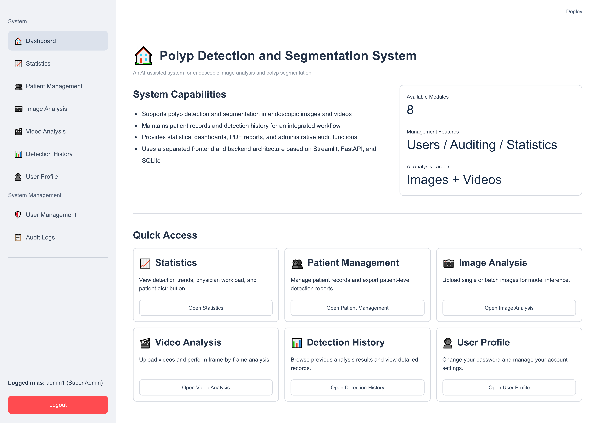

# Frontend — Streamlit Application


Multi-page Streamlit client for the polyp detection system. It contains no model code: every
action is an HTTP call to the FastAPI backend documented in
[../backend/README.md](../backend/README.md).

Parent documents: [../../README.md](../../README.md) · [../README.md](../README.md).

---

## 1. Start the Application

The backend must be running first.

```powershell
# terminal 1 — backend (from the repository root)
python -m uvicorn system.backend.main:app --host 127.0.0.1 --port 8000 --reload

# terminal 2 — frontend (from the repository root)
python -m streamlit run system/frontend/app.py
```

Default address: `http://localhost:8501`.

Changing the port is done with Streamlit's own flag, but the backend URL is **hard-coded** in
`system/frontend/common.py`:

```python
BACKEND_URL = "http://127.0.0.1:8000"
```

If you move the backend, edit that constant — there is no environment-variable override.

---

## 2. Module Layout

```
system/frontend/
├── app.py               # Primary entry point: page registry, auth gate, login/register UI
├── app_fixed.py         # Legacy duplicate entry point (see section 7)
├── common.py            # BACKEND_URL, session helpers, auth headers, patient fetch
└── views/
    ├── Home.py
    ├── Dashboard.py
    ├── Patients.py
    ├── Image_Detection.py
    ├── Video_Detection.py
    ├── History.py
    ├── Profile.py
    ├── User_Management.py    # admin only
    └── Audit_Logs.py         # admin only
```

Neither the frontend package nor `views/` has an `__init__.py`; `app.py` inserts the repository
root into `sys.path` so that `from system.frontend.common import ...` resolves, while each view
inserts `system/frontend` so that `common` is importable as a top-level module.

---

[def]: ./frontend.png